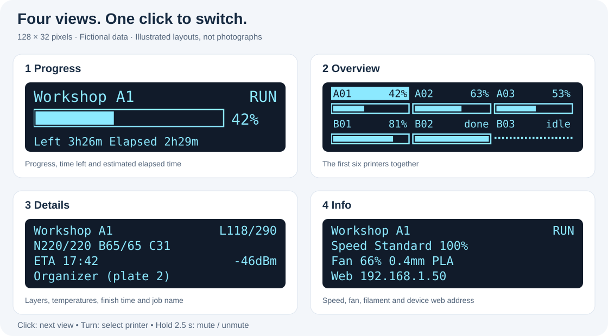
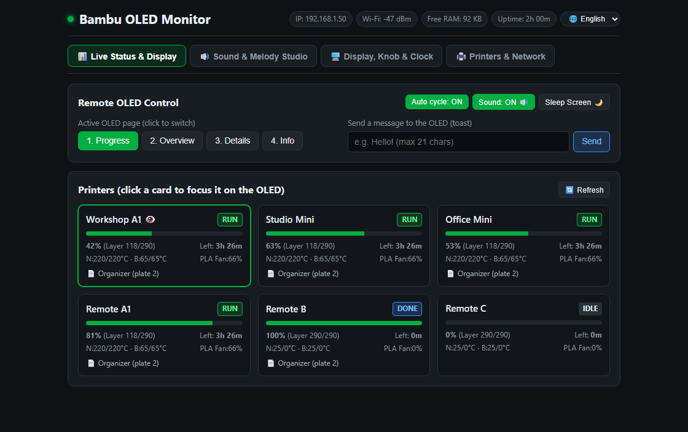
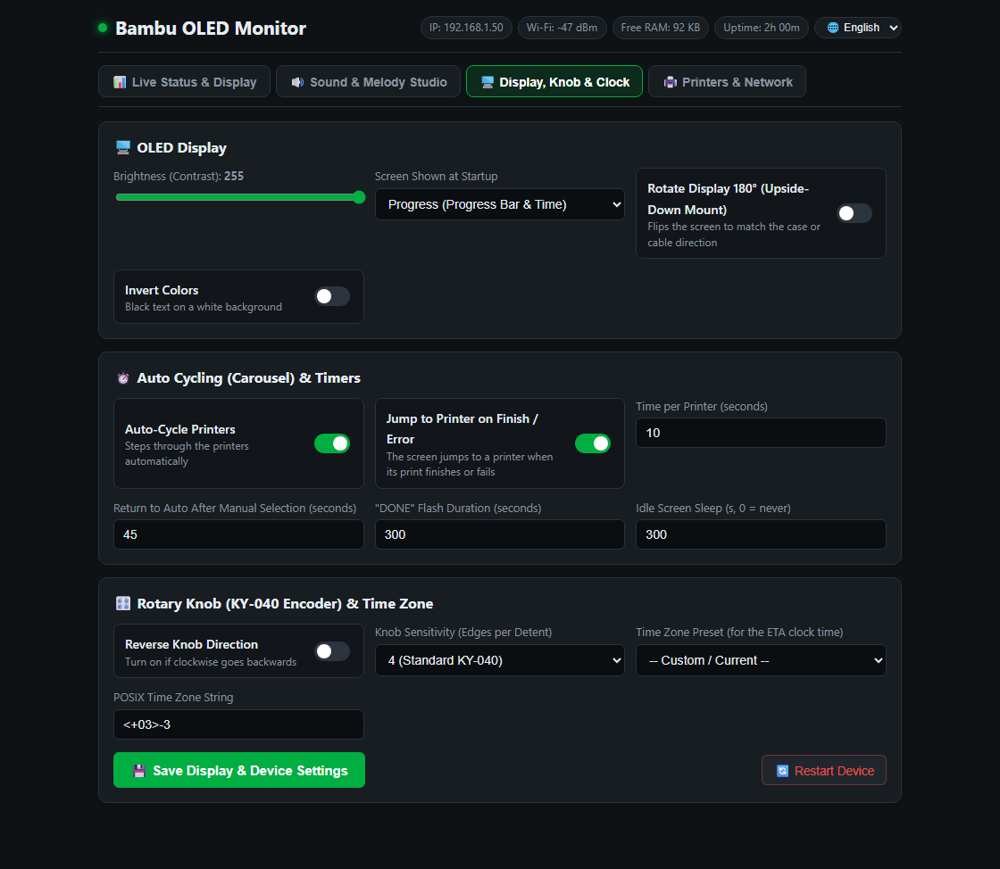
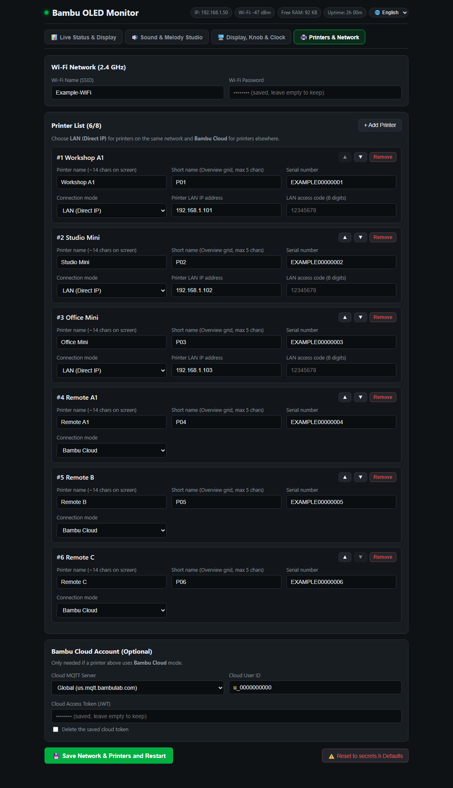

# Bambu OLED Info

**Your Bambu printers, at a glance — on a small screen on your desk.**

An ESP32, a 128×32 OLED and a rotary knob show print progress, time left, temperatures and job details. Add a buzzer for finish and error alerts. Open the built-in web panel to change settings without re-flashing.

[Türkçe](README.tr.md) · [Quick start](#quick-start) · [Wiring](#wiring) · [Detailed reference](docs/reference.md) · [MIT license](LICENSE)



## What it does

| Feature | What you get |
|---|---|
| Up to **8 printers** | Browse individually; see the first **6** together in Overview |
| **LAN + Cloud** | Read nearby printers directly; use Bambu Cloud for remote printers |
| **Four OLED views** | Progress, Overview, Details and Info |
| **Finish / error alerts** | Optional buzzer, flashing status and automatic screen wake-up |
| **Web panel in English / Turkish** | Printers, sound, display, knob and network settings |
| **Read-only printer access** | The firmware cannot start, pause or stop a print |

## What the screens show

The drawing above follows the firmware layouts. It uses example values; it is **not a photograph or an exact pixel capture**. OLED labels are English in both language versions.

| Click order | View | What to look for |
|---|---|---|
| 1 | **Progress** | Percentage, progress bar, time left and estimated elapsed time |
| 2 | **Overview** | Six compact printer cells; the selected one is highlighted |
| 3 | **Details** | Layer, nozzle / bed / chamber temperature, finish time, Wi-Fi and job name |
| 4 | **Info** | Speed, cooling fan, nozzle size, filament, errors / stage / web IP |

`N220/220` means nozzle temperature / target. `B65/65` is bed temperature / target. `ETA` is the estimated finish clock; it needs NTP time. Elapsed time is an estimate, and long job names scroll.

At startup, **Reading printers** appears while the first scan runs. A newly observed finish flashes **DONE** for 5 minutes, then the OLED shows **IDLE**. Jobs already finished at startup do not raise an alert.

## Parts

| Part | Requirement |
|---|---|
| **ESP32-C3 board** | The tested setup uses a CH343 USB-UART board |
| **0.91-inch OLED** | SSD1306, **128×32**, I2C; addresses `0x3C` / `0x3D` supported |
| **KY-040 rotary encoder** | Optional; choose printers and views from the web panel if omitted |
| **Buzzer module** | Optional; 3.3 V compatible signal input, active or passive |
| USB cable + jumper wires | A USB cable that carries data is needed for flashing |
| PlatformIO | CLI or the VS Code extension |

## Wiring

**Disconnect USB before wiring.** This diagram shows the default **ESP32-C3** connections. Module pin positions vary: follow the printed pin names.


| Module | Module pin | ESP32-C3 pin |
|---|---|---|
| OLED | GND / VCC | GND / **3V3** |
| OLED | SDA / SCK (SCL) | **GPIO4 / GPIO5** |
| KY-040 | GND / + | GND / **3V3** |
| KY-040 | CLK / DT / SW | **GPIO6 / GPIO7 / GPIO10** |
| Buzzer module | GND / VCC / S | GND / **3V3 / GPIO3** |

All grounds are common. Power KY-040 `+` from **3V3**, so its pull-ups do not put 5 V on ESP32 signal pins. Change pins in [`include/settings.h`](include/settings.h); other chips have different defaults.

<details>
<summary><strong>Using a bare two-pin buzzer instead?</strong></summary>

The diagram is for a **three-pin module**, with separate power and signal pins. Do not treat a bare buzzer's `+` pin as a module's `S` pin. A bare buzzer that needs more current than the GPIO can supply requires a driver: GPIO3 → 1 kΩ resistor → NPN base; emitter → GND; collector → buzzer `−`; buzzer `+` → its rated supply. Use a common ground and suitable flyback protection for an inductive buzzer. Choose a driver/module compatible with 3.3 V logic.

</details>

## Quick start

### 1. Get the project

```powershell
git clone https://github.com/Asimmimx/bambu-oled-info.git
cd bambu-oled-info
```

Wire the modules, connect USB and install PlatformIO. On Windows use **PowerShell or cmd**, rather than Git Bash. If `pio` is not on PATH, use `python -m platformio` where PlatformIO is installed.

### 2. Flash the firmware

```powershell
pio device list
pio run -e esp32c3 -t upload --upload-port COM6
```

Replace `COM6` with your board's port. The first build downloads its toolchain. This environment is for the tested C3 USB-UART boards; native-USB boards need adjusted USB build flags and a matching board definition. See [the reference](docs/reference.md#platformioini).

No `secrets.h` is required for a fresh build: the firmware falls back to the example configuration. You will replace those example values in the next step.

### 3. Open setup

With no working Wi-Fi credentials, connect your phone or computer to **BambuMonitor-Setup**, then open **http://192.168.4.1**. Stay on that network even if your device reports “no internet”.

In **Printers & Network**, enter your Wi-Fi details and add your printers. Save to restart the device. Once connected, use **http://<device-ip>** on your normal network; find the IP in the serial log or the OLED **Info** view when its last line is available.

### 4. Add a LAN printer

Enter its **name, short name, IP, serial number and LAN access code**. The code is the printer's MQTT password, not your Bambu account password. Reserve the printer's IP in your router so it stays the same.

To discover nearby printers:

```powershell
python tools/find_printers.py
```

Use the printer's LAN access code if you already have it. Otherwise, the optional account tool can fetch codes; see [access codes and cloud setup](#access-codes-and-cloud-setup).

### 5. Check the first scan

The OLED should move from **Connecting WiFi** to **Reading printers**, then display printer status. For diagnostics:

```powershell
pio device monitor --port COM6 --baud 115200
```

Opening the serial port may reset the board. Close the monitor before uploading again.

<details>
<summary><strong>Prefer configuration in a file?</strong></summary>

Copy `include/secrets.example.h` to `include/secrets.h`, fill in your values and flash again. The file is git-ignored. The entries below are fictional:

```cpp
#define WIFI_SSID "your-wifi"
#define WIFI_PASSWORD "your-password"

static const PrinterConfig PRINTERS[] = {
    {"Workshop A1", "A01", "192.168.1.101", "03000A000000001", "00000001"},
};
//   name          short  LAN IP           serial             access code
```

Use `ip = ""` for a cloud printer. Names should fit roughly 13–14 characters; Overview uses the first 5 characters of `shortName`.

**Saved web settings override compile-time defaults**, including after re-flashing. Update the web settings, or deliberately reset the saved configuration through the panel before switching back to file defaults.

</details>

## Everyday use

| Knob action | Result |
|---|---|
| Turn | Select a printer; automatic cycling pauses |
| Click | Next OLED view |
| Hold 0.8–2.5 seconds, then release | Toggle automatic cycling |
| Hold 2.5 seconds | Mute / unmute the buzzer |
| Touch while the display sleeps | Wake it; that first action only wakes the screen |

Defaults: **10 seconds** per printer, automatic cycling resumes **45 seconds** after manual input, and the screen sleeps after **5 minutes** without active prints or errors. Change these in the web panel. Selecting a printer never suspends background monitoring of the others.

| Tag | Meaning |
|---|---|
| `RUN` / `PREP` / `PAUSE` | Printing / preparing / paused |
| `DONE` / `IDLE` | Recently finished / idle |
| `ERR` | Failed print or a reported error |
| `OFF` / `AUTH` | Connection failed / credentials rejected |
| `...` | No status received yet |

If a connection fails, previously received values stay on the OLED with `OFF` / `AUTH` and dotted bars. A connected cloud broker alone does not prove every remote printer is online; displayed values are the last received reports.

## Web panel

The panel is served by the ESP32. No separate server is needed. Its language selector switches between English and Turkish.



*This preview uses the HTML shipped in the firmware and fictional data; it does not expose a real device or account.*

| Tab | Main controls |
|---|---|
| **Live Status & Display** | Printer cards, OLED view, auto-cycle, sleep, mute and screen messages |
| **Sound & Melody Studio** | Volume, buzzer type, polarity, finish/error melodies and sound tests |
| **Display, Knob & Clock** | Brightness, orientation, encoder direction, timers and time zone |
| **Printers & Network** | Wi-Fi, up to 8 printers and Bambu Cloud credentials |

<details>
<summary><strong>Preview the other three tabs</strong></summary>






</details>

For sound, choose the mode matching your hardware: **active flat**, **passive**, **active melodic** or **active chiptune**. The panel offers 7 finish presets, 5 error presets and custom melodies. Active-buzzer modes vary modulation and rhythm; passive buzzers produce the supplied note frequencies. Try the sound test, then check mute, volume and Active-LOW if needed.

## Access codes and cloud setup

**LAN access and cloud access are separate.** A LAN printer uses its IP and access code; a remote printer uses the cloud account credentials and its serial number.

The optional helper runs **on your computer**, asking for credentials privately in your terminal:

```powershell
Copy-Item include/secrets.example.h include/secrets.h  # only if secrets.h does not exist
python tools/fetch_access_codes.py                    # fetch LAN codes
# Or, with a MakerWorld token:
python tools/fetch_access_codes.py --token --cloud    # also prepare cloud printers
```

The helper writes `secrets.h`. Review it locally and either flash those defaults or transfer the needed settings into the web panel. Existing saved web settings still take precedence. In file configuration, an empty printer IP selects cloud access.

Treat the cloud token like a password. It expires and the ESP32 does not renew it automatically; update it in the panel when rejected. Cloud access needs internet and NTP for certificate validation. The default broker targets global accounts; China-region cloud use has not been verified. [Full tool options](docs/reference.md#the-helper-tools).

## How often does it check?

| Connection | Normal checks | Last 10 estimated minutes |
|---|---|---|
| Bambu Cloud | **5 min** | **1 min** |
| LAN | **30 s** | **10 s** |

An open MQTT session processes incoming changes immediately. The ESP32 keeps one TLS session and visits other printers when due; it returns to the shared cloud connection between LAN visits when possible. Times in the table are target intervals after a visit, rather than guaranteed alert delays.

**A missed finish message can still delay an alert.** Some printers send only changed fields. If FINISH arrives while disconnected, recovery may need the next full report. Full-status requests (`pushall`) normally stay **330 seconds apart** to limit printer load. When a running job’s last ETA reaches zero, the firmware requests confirmation at most **once every 60 seconds**, so a missed FINISH does not wait another full 5.5-minute cycle. This exception is limited to the end of a running job; the estimate itself never triggers a finish alert.

## Compatibility

| Hardware | What has actually been checked |
|---|---|
| **ESP32-C3 + SSD1306 + KY-040** | Run on CH343 USB-UART boards |
| **Three A1 mini printers over LAN** | Tested in normal cloud mode, without LAN Only Mode; recorded firmware 01.08.01.00 |
| **Three remote cloud printers** | Status received; owner identifies them as A1, X2D and A2L; model identity not independently verified |
| **ESP32, S2, S3, C6** | Build checks passed; not run on those boards |
| **Buzzer / real failure / finish latency** | Builds and demo coverage; audible output, real failures and new finish latency have not been verified |
| **Other boards and printer models** | Not verified; protocol compatibility alone is not a hardware test |

On **2026-10-21**, all six build environments and host polling tests passed. The C3 flash was verified; a 45-second boot check read all six printers and the web status endpoint without runtime fault markers. It did not include a print finishing. See [verification and development](docs/reference.md#polling-regression-tests).

## Troubleshooting

| Problem | First check |
|---|---|
| OLED is blank | SSD1306 **128×32 I2C**, 3V3, GND, SDA4 and SCL5; inspect `[oled]` serial lines |
| No setup page | Join `BambuMonitor-Setup` and open `http://192.168.4.1`; after Wi-Fi setup use the device's LAN IP |
| Printer shows `OFF` | Printer power, IP, DHCP reservation and guest-network/client isolation |
| Printer shows `AUTH` | LAN access code or cloud token; update the saved web settings |
| Finish alert arrives late | See [polling limits](#how-often-does-it-check); check connection failures in the log |
| Knob direction / steps are wrong | Encoder direction and sensitivity in the web panel |
| Buzzer is silent or always on | Mute, volume, correct active/passive mode, Active-LOW and module wiring |
| Code changes do not change credentials | Saved NVS web configuration overrides `secrets.h` |
| C3 will not boot | Keep this project's pioarduino platform and 40 MHz DIO settings |
| Windows upload fails on Unicode output | Set `PYTHONUTF8=1` and `PYTHONIOENCODING=utf-8` in the terminal |

Keep this device on a trusted LAN: the web panel uses HTTP and has no login. Do not expose it to the public internet. Credentials are stored in device flash / NVS and optionally in `secrets.h`; never commit that file or share unredacted logs. Cloud TLS is verified; local printer certificates are accepted without verification.

## Reference, demo and contributing

- **[Detailed reference](docs/reference.md):** all settings, architecture, helper options, tests and API-related limits.
- **Demo:** `pio run -e demo -t upload` replaces real monitoring with fake printers and skips Wi-Fi. Flash `esp32c3` again to return to real monitoring.
- **Contribute:** include board, printer model, firmware, LAN/cloud mode and a redacted log. State whether you built it or ran it on hardware.
- **Limitations:** no OTA update; no automatic cloud-token renewal; HMS notices are counted rather than decoded.

Unofficial project, not affiliated with Bambu Lab. Protocol research: [OpenBambuAPI](https://github.com/Doridian/OpenBambuAPI). Built with [U8g2](https://github.com/olikraus/u8g2), [PubSubClient](https://github.com/knolleary/pubsubclient), [ArduinoJson](https://arduinojson.org/) and [pioarduino](https://github.com/pioarduino/platform-espressif32). [MIT license](LICENSE).
