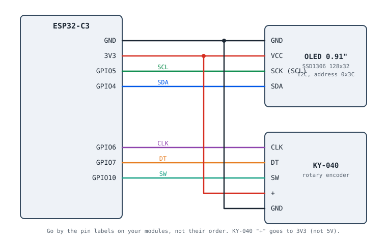

# Bambu OLED Info

[](LICENSE)  

A small desk gadget that shows what your **Bambu Lab printers** are doing, at a glance: progress bar, time left, time elapsed, finish time, temperatures, layer, file name, speed mode, filament and what the printer is busy with right now. It is an **ESP32-C3**, a **0.91" OLED** and a **rotary knob**.

- Printers on your Wi-Fi are read **directly over your local network**. No server, no phone app, no cloud account needed.
- Printers somewhere else (a second house, a workshop) can be read **through your Bambu account**, by the same device.
- It only **reads** status. It never starts, pauses or stops a print.

*[Türkçe sürüm / Turkish version](README.tr.md)*



---

## Contents

1. [Status](#status)
2. [Features](#features)
3. [The screens and the knob](#the-screens-and-the-knob)
4. [What you need](#what-you-need)
5. [Which ESP32 works?](#which-esp32-works)
6. [Wiring](#wiring)
7. [Buzzer (optional)](#buzzer-optional)
8. [Setup, step by step](#setup-step-by-step)
9. [Printers that are not on your Wi-Fi](#printers-that-are-not-on-your-wi-fi)
10. [Configuration reference](#configuration-reference)
11. [How it works](#how-it-works)
12. [Project layout](#project-layout)
13. [The helper tools](#the-helper-tools)
14. [Security and privacy](#security-and-privacy)
15. [Troubleshooting](#troubleshooting)
16. [Limitations and ideas](#limitations-and-ideas)
17. [Contributing](#contributing)
18. [Credits and license](#credits-and-license)

---

## Status

| | |
|---|---|
| **Verified on hardware** | ESP32-C3 on a CH343 USB-UART board (two boards), SSD1306 128x32 OLED, KY-040 knob. Three **A1 mini** printers (firmware 01.08.01.00) on the LAN, in normal cloud mode, **without** LAN Only Mode. Three further printers in another house (an A1, an X2D and an A2L, according to their owner) read through Bambu Cloud. |
| **Not verified** | The buzzer (written and built, not yet run on hardware), other ESP32 chips (they build, see [Which ESP32 works?](#which-esp32-works)), P1 / X1 / H2 series and every other printer model. Failure states (an actual print error) were only exercised with the built-in demo, not with a real failing printer. |

Other models should work in principle, because the status protocol is the same, but I could not test them. Reports are very welcome, see [Contributing](#contributing).

## Features

- **Six printers on one 128x32 screen**, shown one at a time (10 s each) or all together (overview).
- **Live updates** for the printer on screen; the last known state of the others is remembered.
- Works with printers that send **partial** status (A1 family) as well as full status.
- **Finish clock** ("done at 17:42"), from the printer's remaining time and NTP.
- **Cloud mode** for printers on another network, with a verified TLS connection.
- An optional **buzzer** announces finished and failed prints (active or passive buzzer, multiple melodies + custom melody composer, live sound tester; hold the knob button 2.5 s or use the web panel to mute).
- Errors **flash** the header, and a finished print flashes its state tag; an idle farm **switches the screen off** (OLED burn-in) and wakes up when something happens.
- Configurable pins, timings and time zone.
- **Built-in web control panel** (`http://<device-ip>` or fallback setup AP `BambuMonitor-Setup` at `http://192.168.4.1`):
  - **Live dashboard & remote OLED control**: see all printers live in your browser, click a printer card to focus it on the OLED, switch OLED views, toggle auto-cycling/sleep, or send a toast message to the screen.
  - **Sound & melody studio**: adjust buzzer volume (`1-100%`), test sounds live, choose between 4 buzzer modes (including **Active Buzzer Volume-Stepped Melody** and **Chiptune Modulation** so even a fixed-tone active buzzer can play expressive melodies), pick from 7 finish melodies and 5 error melodies, or compose custom melodies (`freq:ms@vol%` or `@vol%:ms`) without re-flashing.
  - **Display, knob & timers**: adjust OLED brightness (contrast), flip 180°, invert colors, reverse knob direction, set step sensitivity, timings and time zone live.
  - **Wi-Fi, printers & Bambu Cloud**: manage up to 8 LAN/Cloud printers and update the Bambu Cloud token in NVS flash.
- **Demo build** with fake printers to preview every screen without any printer.
- Two small Python tools to find your printers and read their access codes.

## The screens and the knob

A single **click** steps through four screens: **Progress → Overview → Details → Info → Progress ...**

| Control | What it does |
|---|---|
| Nothing | **Auto mode**: each printer is shown for 10 s (`CAROUSEL_MS`), then the next one |
| Turn the knob | Choose a printer; auto mode pauses and resumes after 45 s without touching (`MANUAL_TIMEOUT_MS`) |
| Click | Next screen (see above) |
| Long press (0.8 - 2.5 s, acts on release) | Auto mode **on / off**; a message stays on screen for 3 s |
| Very long press (2.5 s) | Sound **on / off** (needs a buzzer) |
| Any touch while the screen is off | Wakes the screen (the touch is not used for anything else) |

All on-screen text is English. The sketches below are layouts, not photographs. The real display is 128x32 pixels, about 21 characters wide.

**Progress**: the main screen.

```
Garage A1                RUN
[=========-----------]   42%
Left 3h26m Elapsed 2h29m
```

Name and state tag on top, a progress bar with the percentage, and below it the time left and the time elapsed. While a printer is preparing a print, the last line shows what it is doing instead (*Heating bed*, *Bed leveling*, *Cleaning nozzle*...). A finished print shows how long it took; an idle printer shows its temperatures.

**Overview**: every printer at once (the first six), as a 3x2 grid.

```
MINI1 42%  MINI2 63%  MINI3 53%
[====---]  [=====--]  [====---]
A1    81%  X2D   done A2L   38%
[======-]  [=======]  [===----]
```

Each cell shows a short name (`shortName`, max. 5 characters), the percentage or a state word (`idle`, `done`, `ERR`, `off`, `AUTH`) and a small bar. The cell of the selected printer is inverted; an error flashes. In auto mode the highlight follows the printer the device is talking to; turn the knob to pick one, and a click moves on to the next screen for that printer.

**Details**

```
Garage A1           L118/290
N220/220 B65/65 C31
ETA 17:42             -46dBm
altbaski.stl + altbaski.stl +
```

Layer, nozzle / bed / chamber temperatures (target after the slash; the chamber only if the printer reports one), the clock time the print will be done (`+1` means tomorrow), Wi-Fi signal, and the file name, which scrolls when it is too long.

**Info**

```
Garage A1                RUN
Speed Standard 100%
Fan 66% 0.4mm PLA
Web 192.168.1.167
```

Speed mode and percentage, part-cooling fan, nozzle diameter, the filament in use (from the AMS slot or the external spool), and the last line: an error code, the printer's current stage, the number of active HMS notices, or the device's web panel IP address (`Web 192.168.x.x`).

**Job finished.** When a printer finishes a job, its `DONE` tag flashes in the top-right corner of the Progress screen, and its cell flashes in the Overview, for 5 minutes (`DONE_ALERT_MS`). After that the printer shows a steady `IDLE`, so a printer that is idle on purpose does not keep drawing your eye. A printer that was already finished when the device started shows `IDLE` right away: there is no way to tell when it finished. An error flashes the whole header and keeps doing so.

**Last known data.** If a printer stops answering (`OFF`) or its credentials are rejected (`AUTH`), its last known values stay on screen: the tag shows what is wrong and the progress bars turn dotted. A full-screen message only appears for a printer that never reported anything.

**Power-up.** The first thing you see is *Reading printers 3/6*: the device reads every printer once before the carousel starts, so no screen has to say "waiting for data".

**State tags**: `RUN` printing, `PAUSE`, `PREP` preparing, `DONE`, `IDLE`, `ERR` failed or error code present, `OFF` not reachable, `AUTH` access code or cloud token rejected, `...` no data yet.

## What you need

| Part | Notes |
|---|---|
| **ESP32-C3** dev board | Tested on a board with a CH343 USB-UART bridge. Native-USB boards (e.g. SuperMini) work with a small change, see [Configuration reference](#configuration-reference). |
| **0.91" OLED, 128x32, SSD1306, I2C** | Four pins: GND, VCC, SCK (= SCL), SDA. Address `0x3C` (`0x3D` is detected too). |
| **KY-040 rotary encoder** | Optional, but it is how you choose a printer. |
| Buzzer | Optional: active or passive, see [Buzzer](#buzzer-optional). |
| Jumper wires, USB cable | |
| [PlatformIO](https://platformio.org/) | CLI or the VS Code extension. |
| Python 3 | Only for the helper tools; they need nothing but the standard library. |

## Which ESP32 works?

The code is plain Arduino (Arduino core 3 on ESP-IDF 5) and uses nothing that is specific to one chip, but I could only **run** it on an ESP32-C3. The other chips below were **built** for this table; their default pins are in [`include/settings.h`](include/settings.h).

| Chip | Status | Notes |
|---|---|---|
| ESP32-C3 | ✅ Tested | Runs on hardware (CH343 boards). Single core, no PSRAM; about 100 KB of heap stay free while connected. |
| ESP32-S3 | 🟡 Should work | Builds (`pio run -e esp32s3`), not run on hardware. More RAM than the C3. |
| ESP32 (classic) | 🟡 Should work | Builds (`-e esp32`), not run on hardware. GPIO 6-11 are the flash, so the default pins differ from those of the C3. |
| ESP32-C6 | 🟡 Should work | Builds (`-e esp32c6`), not run on hardware. Single core like the C3. |
| ESP32-S2 | 🟡 Should work | Builds (`-e esp32s2`), not run on hardware. RAM headroom not measured. |
| ESP32-C2 | ⚠️ Probably too little RAM | Not tried. It has less RAM than the C3, and this firmware needs a TLS session plus a 24 KB message buffer. |
| ESP32-C5 / C61 | ❔ Unknown | Not tried. |
| ESP32-H2 | ❌ No | No Wi-Fi (Thread / Zigbee / BLE only). |
| ESP32-P4 | ❌ No | No built-in Wi-Fi. |

✅ run on hardware · 🟡 builds, not run on hardware · ⚠️ likely RAM-limited · ❔ not tried · ❌ cannot work

To use another chip, flash with its environment (`pio run -e esp32s3 -t upload`) and wire the display, knob and buzzer to that chip's default pins from `settings.h` (or change them). The C3 environment forces 40 MHz DIO flash because the boards I have need it; the other environments keep their board's defaults, so if one stays silent after flashing, try the same two settings (see [Troubleshooting](#troubleshooting)). Reports of a chip that runs, or does not, are very welcome.

## Wiring

| OLED | ESP32-C3 | | KY-040 | ESP32-C3 |
|---|---|---|---|---|
| GND | GND | | CLK | GPIO6 |
| VCC | 3V3 | | DT | GPIO7 |
| SCK (SCL) | GPIO5 | | SW | GPIO10 |
| SDA | GPIO4 | | + | 3V3 (**not** 5V) |
| | | | GND | GND |

- These are the **ESP32-C3** pins; other chips have their own defaults in `settings.h`. The optional buzzer goes to GPIO3 and GND, see [Buzzer](#buzzer-optional).
- Go by the **pin labels** on your modules, not their order; the order differs between manufacturers.
- Power the KY-040 `+` from 3V3: the module has pull-up resistors to that pin, so its signals stay at 3.3 V.
- The pins can be changed in [`include/settings.h`](include/settings.h). Avoid GPIO 2, 8, 9 (boot straps), 11-17 (flash), 18-19 (USB) and 20-21 (UART).
- No extra parts are needed: the KY-040 and most OLED modules already carry their own pull-up resistors, and the firmware also enables the internal pull-ups on the knob pins.

## Buzzer (optional)

A buzzer makes the device useful from across the room: it sounds when a print **finishes** and when one **fails**, and chirps once at power-up so you know it is wired correctly.

### Active or passive?

| | Active buzzer | Passive buzzer |
|---|---|---|
| Inside | its own oscillator | just a coil or piezo, like a tiny speaker |
| Sound | one fixed tone, on / off only | any pitch the chip supplies: notes and melodies |
| Quick test | 3.3 V on its pins: it **beeps** | 3.3 V on its pins: only a **click** |
| In this project | sounds differ by **rhythm** | plays real notes |

If your buzzer can only play a single note, it is an **active** one. That is the default setting (`BUZZER_PASSIVE 0`). For melodies get a passive buzzer and set `BUZZER_PASSIVE 1`.

### Wiring

- **Module with three pins (S, +, -):** `S` → GPIO3, `+` → 3V3, `-` → GND. Many of these modules switch on a LOW signal: if it never stops sounding, or stays silent, set `BUZZER_ACTIVE_LOW 1`.
- **Bare buzzer with two pins:** `+` → GPIO3 and `-` → GND, **only if it draws less than about 20 mA** (small passive piezo discs do). A bare active buzzer often draws more: use a transistor, e.g. an NPN such as a BC547 or 2N2222: GPIO3 → 1 kΩ resistor → base, emitter → GND, buzzer `+` → 3V3, buzzer `-` → collector.
- Never connect a part that expects 5 V signals directly to a GPIO.

### Sounds

| Event | Active buzzer | Passive buzzer |
|---|---|---|
| Power-up | one short beep | one short beep |
| Print finished | beep, beep, long beep | rising notes (C6, E6, G6) |
| Print failed or an error code appears | four beeps | four alternating notes, high and low |

- Only changes seen **live** are announced: a printer that was already finished or failed when the device started stays quiet, and "finished" means the printer was printing, paused or preparing before. In auto mode every printer is visited about once a minute, so an alert for a printer that is not on screen can arrive up to about a minute late.
- Hold the knob button for **2.5 seconds** (or use the web panel) to turn the sound off or on; the mute state is saved in NVS and remembered after a restart.
- From the **Sound & Melody Studio** tab in the web panel (`http://<device-ip>`), you can adjust the **buzzer volume (`1-100%`)**, test sounds live, select **Active Buzzer - Volume-Stepped Melody** or **Chiptune Modulation** (so an active buzzer plays dynamic multi-level melodies instead of flat beeps) or **Passive Buzzer** mode, invert polarity (`Active-LOW`), choose from **7 finish melodies** and **5 error melodies**, or compose your own custom melody (`freq:ms@vol%`, `@vol%:ms`, `0:pause`).
- The demo build (`pio run -e demo -t upload`) plays the sounds as its fake printers finish and fail, which is an easy way to try your wiring offline.
- Compile-time defaults in `settings.h`: `PIN_BUZZER` (`-1` = no buzzer), `BUZZER_PASSIVE`, `BUZZER_ACTIVE_LOW`.

## Setup, step by step

### 1. Get the code

```bash
git clone https://github.com/Asimmimx/bambu-oled-info
cd bambu-oled-info
cp include/secrets.example.h include/secrets.h        # Windows: copy include\secrets.example.h include\secrets.h
```

`include/secrets.h` is git-ignored: it will hold your Wi-Fi password and the printers' access codes. **Never commit it.**

### 2. Look at the screens first (optional)

```bash
pio run -e demo -t upload
```

The demo build needs no Wi-Fi and no printers; it shows fake printers cycling through running, idle, finished, failed and offline.

### 3. Find your printers

Run this on a computer that is on the same network as the printers:

```bash
python tools/find_printers.py
```

```
Name               Model      Serial            IP              Mode     Firmware
Garage A1          A1 mini    0300DA000000000   192.168.1.148   cloud    01.08.01.00
```

It listens for the SSDP announcements that Bambu printers broadcast, so it needs no account and no password. Note the name, **serial number** and **IP** of each one. Give the printers a fixed address (a DHCP reservation in your router) so the IP never changes.

### 4. Edit `include/secrets.h`

```cpp
#define WIFI_SSID     "your-wifi"
#define WIFI_PASSWORD "your-password"

static const PrinterConfig PRINTERS[] = {
    {"Garage A1",  "GARA",  "192.168.1.148", "0300DA000000000", "12345678"},
    //  name       short    LAN address      serial             access code
};
```

The name is shown on the top line (about 14 characters fit); `shortName` (max. 5) is used in the overview. Use plain letters: the display font has no `ş ı ğ İ`.

### 5. Get the access codes

Each printer has an 8-character LAN access code that is the password for its local MQTT service. There are three ways to get it:

**a) From the printer** (official). Turn on **LAN Only Mode** in the printer's settings (on the A1 family it is on the last page of the settings menu); the code is shown right below the switch. The catch: LAN Only Mode disconnects the printer from Bambu Cloud, so remote monitoring and cloud printing stop working for it.

**b) From your Bambu account, with e-mail and password.** This keeps the printers in normal cloud mode:

```bash
python tools/fetch_access_codes.py
```

It asks for your e-mail and password (typed at the prompt, not shown) and, if Bambu asks, the verification code from your e-mail. It lists the printers on your account and writes each access code into `secrets.h`, matching by serial number.

**c) From your Bambu account, with your MakerWorld session.** If you are already signed in to [makerworld.com](https://makerworld.com) (same account) and do not want to deal with the e-mail code:

1. Open makerworld.com in your browser while signed in.
2. Open the developer tools (`F12`) → **Application** (Chrome / Edge) or **Storage** (Firefox) → **Cookies** → `https://makerworld.com`.
3. Copy the **value** of the cookie named `token`.
4. Run `python tools/fetch_access_codes.py --token` and paste it at the prompt (it is not shown).

The token is as powerful as your password for about three months. Do not share it or paste it anywhere else. The script uses it once and does not store it. Both (b) and (c) use Bambu's **unofficial** cloud API, see [Security and privacy](#security-and-privacy).

### 6. Build and flash

```bash
pio run -e esp32c3 -t upload
pio device monitor            # optional: follow the log
```

On Windows run this from **PowerShell or cmd, not Git Bash**; the platform's tool installer refuses MSys. The first build downloads a few hundred MB of toolchain.

### 7. What you should see

At power-up the screen shows *Connecting WiFi*, then the first printer. The serial log (115200 baud) looks like this:

```
[oled] found at 0x3C (SDA=GPIO4 SCL=GPIO5)
[wifi] up, ip 192.168.1.167, rssi -47
[Garage A1] connected in 1287 ms, free heap 105424 (largest block 77812)
[Garage A1] pushall sent
[Garage A1] phase=3 42% left=206min elapsed=149min layer=118/290 nozzle=220/220 ...
```

## Printers that are not on your Wi-Fi

The device only sees the Wi-Fi it is connected to. There are two ways to include printers elsewhere:

**Through Bambu Cloud (one device for everything).** A printer whose `ip` is `""` in `secrets.h` is read through your Bambu account. One command prepares this: it stores your cloud login and adds every printer of your account that is not in `secrets.h` yet:

```bash
python tools/fetch_access_codes.py --token --cloud       # or without --token to log in with e-mail and password
```

- All cloud printers share **one** connection, so switching between them on screen is instant.
- The server certificate is **verified** against the built-in CA bundle before your token is sent, after the clock has been set over NTP.
- The token is compiled into the firmware and is valid for about **three months**. Run the command again and re-flash when a cloud printer shows `AUTH`.
- Global (non-China) accounts only. The broker is `BAMBU_CLOUD_HOST`, default `us.mqtt.bambulab.com`.
- Long names (more than about 14 characters) are cut on screen; rename them in `secrets.h`.

**A second unit.** Build another device with its own `secrets.h` and put it next to those printers. It talks to them locally and never needs the cloud.

## Configuration reference

### `include/settings.h`

| Setting | Default | Meaning |
|---|---|---|
| `PIN_OLED_SDA`, `PIN_OLED_SCL` | 4, 5 | I2C pins of the display |
| `PIN_ENC_CLK`, `PIN_ENC_DT`, `PIN_ENC_SW` | 6, 7, 10 | Knob pins (the defaults here are for the C3; other chips have their own) |
| `PIN_BUZZER` | 3 | Buzzer pin; `-1` = no buzzer |
| `BUZZER_PASSIVE` | 0 | 0 = active buzzer (rhythm only), 1 = passive (notes) |
| `BUZZER_ACTIVE_LOW` | 0 | 1 if the buzzer module sounds when the pin is LOW |
| `ENC_REVERSE` | 0 | Set to 1 if turning clockwise moves backwards |
| `ENC_EDGES_PER_DETENT` | 4 | Try 2 if one click of the knob skips a printer |
| `TIMEZONE` | `<+03>-3` | POSIX time zone for the finish clock, e.g. `CET-1CEST,M3.5.0,M10.5.0/3` |
| `CAROUSEL_MS` | 10000 | Time each printer stays on screen in auto mode |
| `MANUAL_TIMEOUT_MS` | 45000 | Auto mode resumes after this long without touching the knob |
| `DONE_ALERT_MS` | 300000 | A finished job flashes `DONE` this long, then the printer shows a steady `IDLE` |
| `SCREEN_SLEEP_MS` | 300000 | Screen off after this long with nothing printing; 0 = never |
| `AUTO_LISTEN_MS` | 3500 | Overview mode: how long to listen to each printer |
| `FIRST_REPORT_WAIT_MS` | 7000 | Give up on a printer that connects but stays silent |
| `CONNECT_TIMEOUT_S`, `HANDSHAKE_TIMEOUT_S` | 3, 8 | TCP and TLS timeouts |
| `OFFLINE_RETRY_MS` | 60000 | Retry interval for an unreachable printer or rejected credentials |
| `FOCUS_RETRY_MS` | 8000 | Retry interval while that printer is on screen |
| `FOCUS_SETTLE_MS` | 450 | Wait for the knob to stop before connecting |
| `PUSHALL_MIN_INTERVAL_MS` | 330000 | Minimum time between full-status requests per printer (5.5 min) |
| `WARMUP_CLOUD_WAIT_MS` | 8000 | Power-up sweep: how long to wait for the cloud printers to report |
| `HEARTBEAT_MS` | 10000 | Interval of the status line in the serial log |
| `MQTT_BUFFER_BYTES` | 24576 | Largest accepted MQTT message; bigger ones are silently dropped |

### `include/secrets.h`

| Entry | Meaning |
|---|---|
| `WIFI_SSID`, `WIFI_PASSWORD` | Your Wi-Fi (2.4 GHz) |
| `PRINTERS[]` | One entry per printer: `{name, shortName, ip, serial, accessCode}`. `ip` = `""` means "through Bambu Cloud". At most 8 (`MAX_PRINTERS` in `src/Config.h`); the overview shows the first 6. |
| `BAMBU_CLOUD_USER`, `BAMBU_CLOUD_TOKEN`, `BAMBU_CLOUD_HOST` | Only for cloud printers; written by `fetch_access_codes.py --cloud` |

### `platformio.ini`

| Environment | Use |
|---|---|
| `esp32c3` | The real firmware |
| `demo` | Same UI with fake printers and no Wi-Fi |
| `esp32s3`, `esp32`, `esp32c6`, `esp32s2` | Other chips, build-tested only, see [Which ESP32 works?](#which-esp32-works) |

For a board with **native USB** (no separate USB-UART chip), delete the two `-DARDUINO_USB_...` lines from `build_flags`. Other boards: change `board`. The platform is [pioarduino](https://github.com/pioarduino/platform-espressif32) (Arduino core 3), and the flash is forced to 40 MHz DIO (see [Troubleshooting](#troubleshooting)).

## How it works

### The big picture

```
 Printers on the LAN ──┐                      ┌── Knob ─────► input ─┐
   (MQTT/TLS :8883)    ├─► poller task ─► state ◄── ui (loop) ◄─────┘
 Bambu Cloud ──────────┘   (one session)   (shared, locked)   │
   (MQTT/TLS :8883)                                           └──► OLED
```

Two tasks share a small, mutex-protected table with the last known status of every printer:

- The **poller** (`src/Poller.cpp`) owns the network. It talks to one MQTT broker at a time and writes what it learns into the table.
- The **UI** (`src/Ui.cpp`, in the Arduino `loop`) reads the table, draws the screens and handles the knob. The knob itself is decoded in an interrupt (`src/Input.cpp`).

### Why one connection at a time

An ESP32-C3 has about 300 KB of RAM. A TLS session costs tens of KB, so six sessions do not fit. Instead the poller keeps **one** session and moves it where you are looking: in auto mode and while you browse it stays connected to the printer on screen (live updates); switching costs about 1.3 s, during which the last known values are shown. The overview has no single printer, so there the poller visits them in turn. All cloud printers are served by one cloud session.

### The status protocol

A printer runs an MQTT broker on port 8883 (TLS). The device logs in with user `bblp` and the printer's **access code**, subscribes to `device/<serial>/report` and asks for a full status once by publishing `{"pushing":{"command":"pushall"}}` to `device/<serial>/request`. For cloud printers the broker is Bambu's, the user is `u_<your account id>` and the password is your token; the topics are the same. The protocol is documented by the community in [OpenBambuAPI](https://github.com/Doridian/OpenBambuAPI).

The fields used (all under `print`): `gcode_state`, `mc_percent`, `mc_remaining_time`, `layer_num`, `total_layer_num`, `nozzle_temper`, `nozzle_target_temper`, `bed_temper`, `bed_target_temper`, `chamber_temper`, `print_error`, `hms`, `wifi_signal`, `subtask_name` / `gcode_file`, `spd_lvl`, `spd_mag`, `stg_cur`, `cooling_fan_speed`, `nozzle_diameter`, `ams.tray_now`, `ams.ams[].tray[].tray_type` and `vt_tray.tray_type`. Each message is filtered while it is parsed, so a 9 KB report costs only a few hundred bytes of RAM.

### Details worth knowing

- **Partial reports.** Printers like the A1 only send fields that *changed*. The firmware merges them into the remembered state, and asks for a full picture (`pushall`) on the first visit and then at most every **5.5 minutes**: Bambu advises against asking more often because the printer's CPU can lag.
- **Power-up sweep.** Before the carousel starts, every printer is read once (LAN printers one by one, then one cloud session for all cloud printers), which takes about ten seconds for six printers.
- **Time elapsed is an estimate.** Printers report the time *left* and the percentage, not the time already spent. Elapsed time is `left × percent / (100 − percent)` for 1-99 %, so it is approximate, and unknown for a print that finished before the device started.
- **Finish clock.** `now + time left`, using NTP and your `TIMEZONE`.
- **Back-off.** An unreachable printer is retried every 60 s (8 s while it is on screen). Rejected credentials are retried at most once a minute, and looking at such a printer does not bring the retry forward.
- **TLS.** Printers use self-signed certificates on your LAN, which are accepted as they are. The cloud server's certificate is checked against the built-in Mozilla CA bundle before the token is sent.
- **File names** are converted to ASCII for the display font: Turkish letters are folded (ğ → g) and anything unsupported becomes `?`.
- **Memory.** About 100 KB of heap stays free while connected (minimum seen: 84 KB); the firmware is about 1.3 MB in a 3 MB partition (no OTA).
- **Screen sleep.** If no printer is printing, paused, preparing or in error for 5 minutes, the screen turns off; a knob touch or new activity wakes it.
- **Boot diagnostics.** The log says where the display answered (`[oled] found at 0x3C ...`) and, if it is silent on the configured pins, scans all other pin pairs to tell you where it is wired.

## Project layout

```
platformio.ini            build environments (esp32c3, demo), platform and flash settings
include/settings.h        pins, timings, language, time zone
include/secrets.example.h template for your git-ignored secrets.h
src/main.cpp              setup + loop, periodic status line
src/Config.*              printer list and credentials (NVS + secrets.h defaults)
src/Web.*                 built-in HTTP configuration page and captive-portal AP
src/State.*               shared status table (mutex-protected)
src/Poller.*              MQTT sessions, parsing, back-off, cloud, demo data
src/Input.*               knob decoding (interrupts) and button (click / long / very long press)
src/Buzzer.*              optional buzzer: patterns for active and passive buzzers
src/Ui.*                  display, screens, carousel, toast, screen sleep
tools/find_printers.py    list printers on the LAN (SSDP)
tools/fetch_access_codes.py  read access codes / cloud login from your Bambu account
docs/wiring.svg           wiring diagram
```

## The helper tools

Both are plain Python 3 scripts with no dependencies.

**`tools/find_printers.py [--seconds 40]`** listens for the SSDP announcements of Bambu printers and prints name, model, serial number, IP, connection mode (e.g. `cloud`) and firmware. It sends nothing.

**`tools/fetch_access_codes.py`**

| Option | Effect |
|---|---|
| *(none)* | Log in with e-mail and password (asks for the e-mail code if needed) |
| `--token` | Paste the `token` cookie of makerworld.com instead of logging in |
| `--cloud` | Also store the cloud login in `secrets.h` and add the account's other printers as cloud printers |
| `--export-others` | Save printers that are not in `secrets.h` to `include/secrets.others.h` (git-ignored) |
| `--cn` | China-region account (the firmware's cloud mode is not tested for it) |
| `--secrets PATH` | Another `secrets.h` |

It makes a backup (`secrets.h.bak`), prints a table of your printers, and **never prints or stores your password or token** (with `--cloud` the token is written to `secrets.h` on purpose). It identifies itself honestly as `bambu-oled-info`; it does not pretend to be a Bambu app.

## Security and privacy

- **What lives where.** Wi-Fi password, access codes, serial numbers and the cloud token are only in `include/secrets.h` (git-ignored, with `.bak` copies and `secrets.*.h` also ignored) and, compiled in, in the device's flash. Check `git status` before you push.
- **The cloud token is a password** to your Bambu account for about three months. With `--cloud` it sits in the flash of the device, so treat the device like a key: if you lose it or hand it on, change your Bambu password. LAN-only use does not need a token at all.
- **Read-only.** The only message the firmware publishes is the status request (`pushall`). It cannot control your printers.
- **LAN TLS is not verified.** Printers use self-signed certificates, so on your network a person with access to it could impersonate a printer. The device only sends the access code to the address in `secrets.h`.
- **Unofficial API.** The account tools and cloud mode use Bambu's undocumented cloud API. Bambu can change or restrict it at any time, and automated use of an account is something they may not appreciate. Use it for your own printers, at your own risk.

## Troubleshooting

| Symptom | Likely cause and fix |
|---|---|
| Board completely silent, no serial output, even after flashing | Many ESP32-C3 boards cannot read their flash at 80 MHz: the bootloader loops on `partition 0 invalid magic number` (visible only with the modern bootloader). This repo forces 40 MHz DIO and the pioarduino platform. If you change the platform, keep those settings. |
| Build fails with `MSys/Mingw is not supported` | Run `pio` from PowerShell or cmd, not Git Bash. |
| OLED stays blank | Open `pio device monitor`. The log says `[oled] found at 0x3C` or scans every pin pair and reports where the display answers. No answer anywhere: check VCC (3V3), GND and solder joints. |
| Knob or button does nothing | The log prints `[input] left / right / click / long press` for every event, and the 10 s status line shows `clk= dt= sw=` (all 1 at rest; `sw` is 0 while pressed). A level that never changes means wiring. Rotation reversed: `ENC_REVERSE`. One click skips: `ENC_EDGES_PER_DETENT`. |
| Printer shows `AUTH` | Wrong access code. For a cloud printer: the token expired, run `fetch_access_codes.py --token --cloud` again and re-flash. |
| Printer shows `OFF` | Printer is off, or not reachable from this network (other subnet, guest Wi-Fi, client isolation). |
| "Waiting for data" stays on screen | The printer never reported anything since power-up. The log shows `connected but no full report received` if the status request got no answer. |
| A large printer never updates | Its messages may exceed `MQTT_BUFFER_BYTES`; the log prints the largest message seen. Raise the value. |
| Finish time is missing | NTP has not synced (needs internet), or the printer is not printing. |
| Buzzer silent | Check `PIN_BUZZER` and the wiring; it chirps once at power-up. A passive buzzer needs `BUZZER_PASSIVE 1` to play notes. Muted? Hold the button 2.5 s. |
| Buzzer never stops, or sounds when it should not | The module switches on LOW: set `BUZZER_ACTIVE_LOW 1`. |
| Letters missing in names | The font has no `ş ı ğ İ`; use plain letters in `secrets.h`. |

## Limitations and ideas

- Only a few models were tested, see [Status](#status).
- The cloud token cannot be refreshed automatically by the device (Bambu's refresh endpoint is unusable), so it must be updated every ~3 months through the web configuration page (`http://<device-ip>`) or by re-flashing.
- No over-the-air firmware updates (the large partition replaces the OTA layout).
- HMS notices are only counted, not decoded; the elapsed time is an estimate.
- Ideas: an LED when a print finishes, Home Assistant / MQTT output, a bigger display with a list view, per-printer thresholds.

## Contributing

Issues and pull requests are welcome. The most useful report is a **model that works or does not**: please include the printer model, firmware version, whether it was a LAN or cloud printer, and the serial log of one carousel cycle (remove your serial number and codes first). Test a change with `pio run -e esp32c3` and `pio run -e demo`; both must build without warnings.

## Credits and license

Unofficial and not affiliated with Bambu Lab. The protocol knowledge comes from the community project [OpenBambuAPI](https://github.com/Doridian/OpenBambuAPI). Libraries: [U8g2](https://github.com/olikraus/u8g2), [PubSubClient](https://github.com/knolleary/pubsubclient) and [ArduinoJson](https://arduinojson.org/); platform: [pioarduino](https://github.com/pioarduino/platform-espressif32).

Released under the [MIT License](LICENSE).
