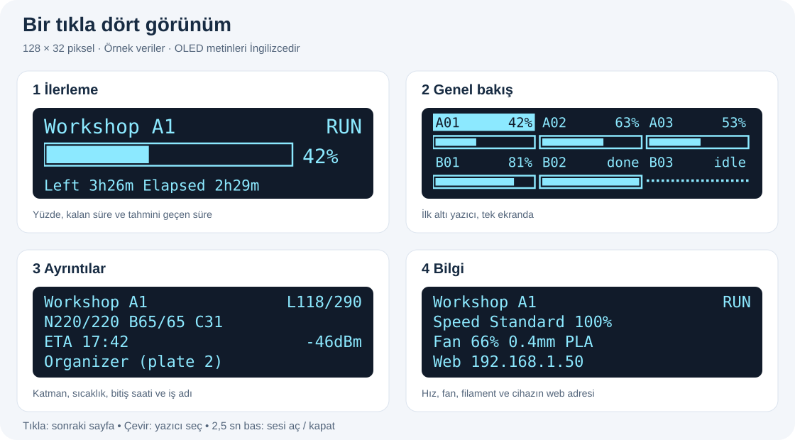
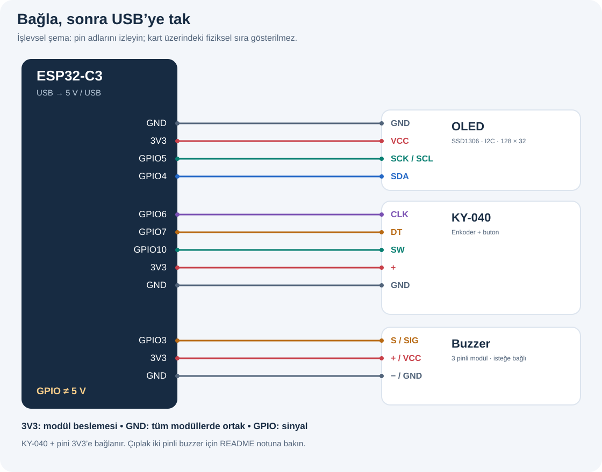
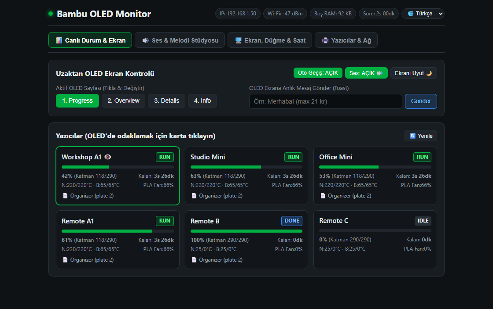
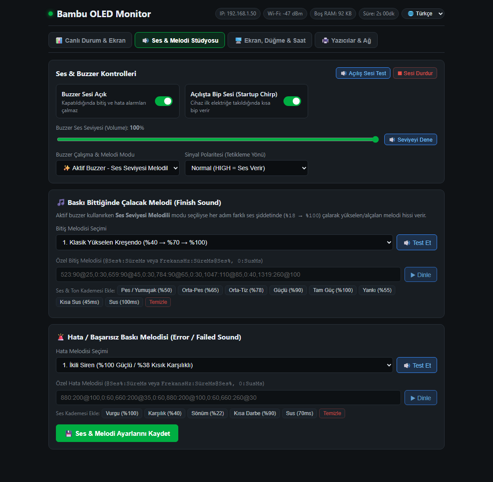
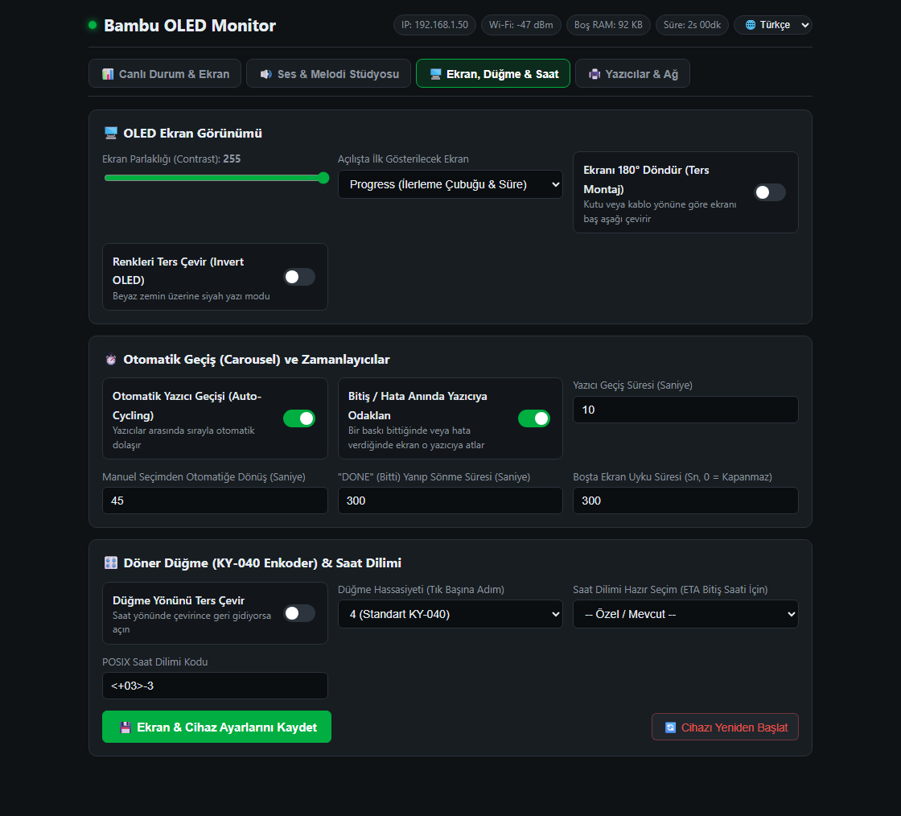
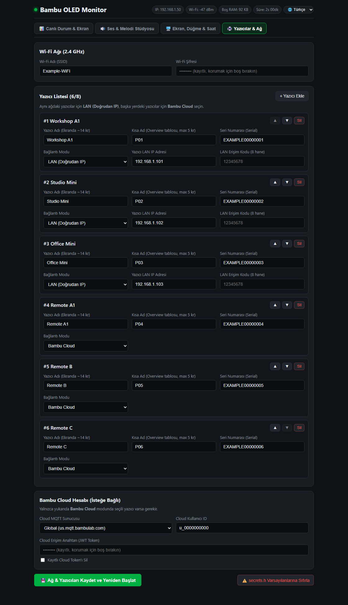

# Bambu OLED Info

**Bambu yazıcılarınızın durumu, masanızdaki küçük bir ekranda.**

ESP32, 128×32 OLED ve döner düğmeyle baskı yüzdesini, kalan süreyi, sıcaklıkları ve iş ayrıntılarını izleyin. İsterseniz bitiş ve hata uyarıları için buzzer ekleyin. Ayarları yeniden yazılım yüklemeden dahili web panelinden değiştirin.

[English](README.md) · [Hızlı kurulum](#hızlı-kurulum) · [Bağlantılar](#bağlantılar) · [Ayrıntılı başvuru](docs/reference.tr.md) · [MIT lisansı](LICENSE)



## Neler yapar?

| Özellik | Kullanımı |
|---|---|
| En çok **8 yazıcı** | Tek tek gezinin; genel bakışta ilk **6** yazıcıyı birlikte görün |
| **LAN + Bulut** | Yakındaki yazıcıları doğrudan, uzaktakileri Bambu Cloud üzerinden okuyun |
| **Dört OLED sayfası** | İlerleme, Genel bakış, Ayrıntılar ve Bilgi |
| **Bitiş / hata uyarıları** | İsteğe bağlı buzzer, yanıp sönen durum ve ekranın uyanması |
| **Türkçe / İngilizce web paneli** | Yazıcı, ses, ekran, düğme ve ağ ayarları |
| **Salt okunur yazıcı erişimi** | Yazılım baskı başlatamaz, duraklatamaz veya durduramaz |

## Ekranlarda ne görünür?

Yukarıdaki çizim firmware’deki sayfa düzenlerini temel alır. Veriler örnektir; görsel **fotoğraf veya birebir piksel çıktısı değildir**. Her iki dilde de OLED metinleri İngilizcedir.

| Tıklama sırası | Sayfa | Gösterilenler |
|---|---|---|
| 1 | **Progress — İlerleme** | Yüzde, ilerleme çubuğu, kalan süre ve tahmini geçen süre |
| 2 | **Overview — Genel bakış** | Altı yazıcı hücresi; seçili yazıcı vurgulanır |
| 3 | **Details — Ayrıntılar** | Katman, nozul / tabla / hazne sıcaklığı, bitiş saati, Wi-Fi ve iş adı |
| 4 | **Info — Bilgi** | Hız, soğutma fanı, nozul çapı, filament, hata / aşama / web IP’si |

`N220/220`, nozulun mevcut / hedef sıcaklığıdır. `B65/65`, tablanın mevcut / hedef sıcaklığıdır. `ETA`, tahmini bitiş saatidir ve NTP ile saat eşitlemesi gerektirir. Geçen süre tahminidir; uzun iş adları kaydırılır.

Açılışta ilk tarama sırasında **Reading printers** görünür. İzleme sırasında yeni görülen bir bitişte **DONE** 5 dakika yanıp söner, ardından OLED’de **IDLE** gösterilir. Cihaz açıldığında zaten bitmiş işler uyarı üretmez.

## Gerekenler

| Parça | Gereksinim |
|---|---|
| **ESP32-C3 kart** | Denenen kurulumda CH343 USB-UART’lı kart kullanılıyor |
| **0,91 inç OLED** | SSD1306, **128×32**, I2C; `0x3C` / `0x3D` adresleri desteklenir |
| **KY-040 döner enkoder** | İsteğe bağlı; yoksa yazıcı ve sayfa seçimi web panelinden yapılabilir |
| **Buzzer modülü** | İsteğe bağlı; 3,3 V sinyalle uyumlu, aktif veya pasif |
| USB kablosu + jumper kablolar | Yazılım yüklemek için veri taşıyan USB kablosu gerekir |
| PlatformIO | Komut satırı veya VS Code eklentisi |

## Bağlantılar

**Bağlantı yaparken USB kablosunu çıkarın.** Şema varsayılan **ESP32-C3** pinleri içindir. Modüllerde pin sırası değişebilir; basılı pin adlarını izleyin.



| Modül | Modül pini | ESP32-C3 pini |
|---|---|---|
| OLED | GND / VCC | GND / **3V3** |
| OLED | SDA / SCK (SCL) | **GPIO4 / GPIO5** |
| KY-040 | GND / + | GND / **3V3** |
| KY-040 | CLK / DT / SW | **GPIO6 / GPIO7 / GPIO10** |
| Buzzer modülü | GND / VCC / S | GND / **3V3 / GPIO3** |

Tüm GND bağlantıları ortaktır. KY-040 `+` pinini **3V3**’e bağlayın; böylece modülün pull-up dirençleri ESP32 sinyal pinlerine 5 V taşımaz. Pinler [`include/settings.h`](include/settings.h) dosyasından değişir; diğer çiplerin varsayılanları farklıdır.

<details>
<summary><strong>Üç pinli modül yerine çıplak iki pinli buzzer mı kullanıyorsunuz?</strong></summary>

Şema, beslemesi ve sinyal girişi ayrı olan **üç pinli modül** içindir. Çıplak buzzer’ın `+` pini, modülün `S` piniyle aynı işlevi görmez. GPIO’nun sağlayabileceğinden fazla akım isteyen çıplak buzzer için sürücü gerekir: GPIO3 → 1 kΩ direnç → NPN baz; emiter → GND; kolektör → buzzer `−`; buzzer `+` → uygun besleme. Toprağı ortak bağlayın; bobinli buzzer’da uygun geri tepme koruması kullanın. Sürücü/modül 3,3 V mantıkla uyumlu olmalıdır.

</details>

## Hızlı kurulum

### 1. Projeyi indirin

```powershell
git clone https://github.com/Asimmimx/bambu-oled-info.git
cd bambu-oled-info
```

Modülleri bağlayın, USB’yi takın ve PlatformIO’yu kurun. Windows’ta **PowerShell veya cmd** kullanın. `pio` bulunamıyorsa PlatformIO’nun kurulu olduğu Python ortamında `python -m platformio` kullanabilirsiniz.

### 2. Yazılımı yükleyin

```powershell
pio device list
pio run -e esp32c3 -t upload --upload-port COM6
```

`COM6` yerine kartınızın portunu yazın. İlk derleme araç zincirini indirir. Bu ortam denenen C3 USB-UART kartları içindir; doğrudan USB kullanan kartlarda USB derleme bayrakları ve kart tanımı uyarlanmalıdır. [Başvuruya bakın](docs/reference.tr.md#platformioini).

İlk derleme için `secrets.h` şart değildir; yazılım örnek yapılandırmaya döner. Sonraki adımda örnek değerleri kendi ayarlarınızla değiştireceksiniz.

### 3. Kurulum sayfasını açın

Çalışan Wi-Fi bilgisi yoksa telefon veya bilgisayarınızı **BambuMonitor-Setup** ağına bağlayın ve **http://192.168.4.1** adresini açın. “İnternet yok” uyarısı çıksa da bu ağda kalın.

**Yazıcılar & Ağ** sekmesinde Wi-Fi bilgilerinizi girip yazıcılarınızı ekleyin. Kaydedince cihaz yeniden başlar. Bağlandıktan sonra normal ağınızdan **http://<cihaz-ip>** adresini kullanın. IP’yi seri günlükten veya son satırı uygunsa OLED **Info** sayfasından bulun.

### 4. LAN yazıcısını ekleyin

Yazıcının **adını, kısa adını, IP’sini, seri numarasını ve LAN erişim kodunu** girin. Bu kod yazıcının MQTT şifresidir; Bambu hesabınızın şifresi değildir. IP değişmesin diye yönlendiricinizde DHCP rezervasyonu yapın.

Yakındaki yazıcıları bulmak için:

```powershell
python tools/find_printers.py
```

LAN erişim kodunu biliyorsanız onu kullanın. Bilmiyorsanız isteğe bağlı hesap aracı kodları alabilir; [erişim kodları ve bulut kurulumu](#erişim-kodları-ve-bulut-kurulumu) bölümüne bakın.

### 5. İlk taramayı kontrol edin

OLED’de **Connecting WiFi**, ardından **Reading printers** ve yazıcı durumu görünmelidir. Tanılama için:

```powershell
pio device monitor --port COM6 --baud 115200
```

Seri portu açmak kartı yeniden başlatabilir. Tekrar yüklemeden önce seri monitörü kapatın.

<details>
<summary><strong>Ayarları dosyada tutmayı mı tercih ediyorsunuz?</strong></summary>

`include/secrets.example.h` dosyasını `include/secrets.h` olarak kopyalayın, bilgileri doldurun ve tekrar yükleyin. Bu dosya Git dışında tutulur. Aşağıdaki bilgiler hayalidir:

```cpp
#define WIFI_SSID "your-wifi"
#define WIFI_PASSWORD "your-password"

static const PrinterConfig PRINTERS[] = {
    {"Workshop A1", "A01", "192.168.1.101", "03000A000000001", "00000001"},
};
//   ad            kisa   LAN IP           seri no            erisim kodu
```

Bulut yazıcısında `ip = ""` kullanılır. Adları yaklaşık 13–14 karakterde tutun; genel bakış `shortName` alanının ilk 5 karakterini gösterir.

**Web’den kaydedilen ayarlar, yeniden yazılım yüklense de dosyadaki varsayılanların önüne geçer.** Dosya varsayılanlarına dönmek için web ayarlarını güncelleyin veya kayıtlı yapılandırmayı panelden bilinçli olarak sıfırlayın.

</details>

## Günlük kullanım

| Düğme hareketi | Sonuç |
|---|---|
| Çevir | Yazıcı seçilir; otomatik geçiş duraklar |
| Tıkla | Sonraki OLED sayfası |
| 0,8–2,5 saniye basıp bırak | Otomatik geçiş açılır / kapanır |
| 2,5 saniye basılı tut | Buzzer sesi açılır / kapanır |
| Ekran uykudayken dokun | Ekran uyanır; ilk hareket yalnızca uyandırır |

Varsayılanlar: yazıcı başına **10 saniye**, elle seçimden **45 saniye** sonra otomatik geçişe dönüş, etkin baskı veya hata yoksa **5 dakika** sonra ekran uykusu. Bunları web panelinden değiştirin. Yazıcı seçimi diğerlerinin arka planda izlenmesini durdurmaz.

| Etiket | Anlamı |
|---|---|
| `RUN` / `PREP` / `PAUSE` | Basıyor / hazırlanıyor / duraklatılmış |
| `DONE` / `IDLE` | Yeni bitmiş / boşta |
| `ERR` | Başarısız baskı veya bildirilen hata |
| `OFF` / `AUTH` | Bağlantı kurulamadı / erişim bilgisi reddedildi |
| `...` | Henüz durum alınmadı |

Bağlantı başarısızsa son değerler OLED’de `OFF` / `AUTH` ve noktalı çubuklarla kalır. Bulut sunucusuna bağlanmak, her uzak yazıcının çevrimiçi olduğunu tek başına kanıtlamaz; gösterilenler son alınan raporlardır.

## Web paneli

Paneli ESP32 sunar; ayrı sunucu gerekmez. Dil seçicisinden Türkçe veya İngilizce seçebilirsiniz.



*Önizleme firmware’deki gerçek HTML ve hayali verilerle oluşturuldu; gerçek cihaz veya hesap bilgisi içermez.*

| Sekme | Temel işlevler |
|---|---|
| **Canlı Durum & Ekran** | Yazıcı kartları, OLED sayfası, otomatik geçiş, uyku, ses ve ekran mesajları |
| **Ses & Melodi Stüdyosu** | Ses seviyesi, buzzer tipi, sinyal yönü, bitiş/hata melodileri ve ses testi |
| **Ekran, Düğme & Saat** | Parlaklık, yön, enkoder yönü, süreler ve saat dilimi |
| **Yazıcılar & Ağ** | Wi-Fi, en çok 8 yazıcı ve Bambu Cloud erişim bilgileri |

<details>
<summary><strong>Diğer üç sekmenin önizlemesi</strong></summary>







</details>

Buzzer’ınıza uygun modu seçin: **aktif düz**, **pasif**, **aktif melodili** veya **aktif chiptune**. Panelde 7 bitiş, 5 hata melodisi ve özel melodi desteği vardır. Aktif modlar modülasyonu ve ritmi değiştirir; pasif buzzer verilen nota frekansını üretir. Ses testini deneyin; gerekirse sessiz durumu, ses seviyesi ve Active-LOW ayarını kontrol edin.

## Erişim kodları ve bulut kurulumu

**LAN erişimiyle bulut erişimi ayrıdır.** LAN yazıcısı IP ve erişim kodunu; uzak yazıcı bulut hesabının erişim bilgilerini ve kendi seri numarasını kullanır.

İsteğe bağlı yardımcı araç **bilgisayarınızda** çalışır; bilgileri terminalde gizli girişle sorar:

```powershell
Copy-Item include/secrets.example.h include/secrets.h  # yalnızca secrets.h yoksa
python tools/fetch_access_codes.py                    # LAN kodlarını al
# Veya MakerWorld anahtarıyla:
python tools/fetch_access_codes.py --token --cloud    # bulut yazıcılarını da hazırla
```

Araç `secrets.h` dosyasını yazar. Dosyayı kendi bilgisayarınızda inceleyip varsayılanları yükleyin veya gerekli ayarları web paneline aktarın. Kayıtlı web ayarları yine önceliklidir. Dosyada IP’nin boş bırakılması bulut erişimini seçer.

Bulut anahtarını şifre gibi koruyun. Süresi dolar ve ESP32 kendiliğinden yenilemez; reddedildiğinde panelden güncelleyin. Bulut erişimi, sertifika doğrulaması için internet ve NTP gerektirir. Varsayılan sunucu global hesaplar içindir; Çin bölgesi bulut kullanımı doğrulanmadı. [Tüm araç seçenekleri](docs/reference.tr.md#yardımcı-araçlar).

## Ne sıklıkla kontrol eder?

| Bağlantı | Normal kontrol | Son 10 tahmini dakika |
|---|---|---|
| Bambu Cloud | **5 dk** | **1 dk** |
| LAN | **30 sn** | **10 sn** |

Açık MQTT oturumundaki değişiklikler hemen işlenir. ESP32 tek TLS oturumu tutar ve süresi gelen diğer yazıcıları ziyaret eder; mümkün olduğunda LAN ziyaretleri arasında ortak bulut bağlantısına döner. Tablodakiler ziyaret sonundan başlayan hedef aralıklardır; bildirim gecikmesi garantisi değildir.

**Kaçırılan bitiş mesajı uyarıyı yine geciktirebilir.** Bazı yazıcılar yalnızca değişen alanları gönderir. Bağlantı kapalıyken FINISH gelirse sonraki tam rapor gerekebilir. Yazıcı yükünü azaltmak için tam durum istekleri (`pushall`) normalde **330 saniye arayla** gönderilir. Çalışan baskının son tahmini süresi sıfıra ulaştığında en fazla **60 saniyede bir** tam durum doğrulaması istenir; kaçırılan FINISH için tekrar 5,5 dakikalık döngü beklenmez. Bu istisna yalnızca çalışan işin sonuna uygulanır; süre tahmini tek başına bitiş uyarısı vermez.

## Uyumluluk

| Donanım | Gerçekte kontrol edilen |
|---|---|
| **ESP32-C3 + SSD1306 + KY-040** | CH343 USB-UART kartlarda çalıştırıldı |
| **LAN üzerinden üç A1 mini** | LAN Only Mode kapalı, normal bulut modunda denendi; kaydedilen firmware 01.08.01.00 |
| **Üç uzak bulut yazıcısı** | Durumları alındı; sahibi A1, X2D ve A2L olarak belirtiyor; model kimliği bağımsız doğrulanmadı |
| **ESP32, S2, S3, C6** | Derlemeler geçti; bu kartlarda çalıştırılmadı |
| **Buzzer / gerçek hata / bitiş gecikmesi** | Derleme ve demo kapsamı var; sesin duyulması, gerçek hata ve yeni bitiş gecikmesi doğrulanmadı |
| **Diğer kart ve yazıcı modelleri** | Doğrulanmadı; ortak protokol tek başına donanım testi değildir |

**2026-10-21** tarihinde altı derleme ortamı ve ana bilgisayar zamanlama testleri geçti. C3’e yükleme doğrulandı; 45 saniyelik açılış kontrolünde altı yazıcı ve web durum yanıtı çalışma hatası işareti olmadan okundu. Test sırasında bir baskı bitişi gözlenmedi. [Doğrulama ve geliştirme](docs/reference.tr.md#zamanlama-regresyon-testleri).

## Sorun giderme

| Sorun | İlk kontrol |
|---|---|
| OLED boş | SSD1306 **128×32 I2C**, 3V3, GND, SDA4 ve SCL5; seri günlükte `[oled]` satırları |
| Kurulum sayfası açılmıyor | `BambuMonitor-Setup` ağına katılıp `http://192.168.4.1` açın; Wi-Fi kurulunca cihazın LAN IP’sini kullanın |
| Yazıcı `OFF` gösteriyor | Yazıcının açık olması, IP, DHCP rezervasyonu ve misafir ağı/istemci yalıtımı |
| Yazıcı `AUTH` gösteriyor | LAN erişim kodu veya bulut anahtarı; kayıtlı web ayarlarını güncelleyin |
| Bitiş uyarısı gecikiyor | [Kontrol sınırlarını](#ne-sıklıkla-kontrol-eder) ve günlükteki bağlantı hatalarını inceleyin |
| Düğme ters dönüyor / adım atlıyor | Panelde enkoder yönü ve hassasiyeti |
| Buzzer sessiz / sürekli ötüyor | Sessiz modu, ses seviyesi, aktif/pasif seçimi, Active-LOW ve modül bağlantısı |
| Kod değişse de erişim bilgisi değişmiyor | NVS’deki web yapılandırması `secrets.h` dosyasının önüne geçer |
| C3 açılmıyor | Projedeki pioarduino platformunu ve 40 MHz DIO ayarlarını koruyun |
| Windows yüklemesinde Unicode hatası | Terminalde `PYTHONUTF8=1` ve `PYTHONIOENCODING=utf-8` ayarlayın |

Cihazı güvendiğiniz LAN’da tutun: web paneli HTTP kullanır ve giriş ekranı yoktur. İnternete doğrudan açmayın. Bilgiler cihazın flash/NVS belleğinde ve isteğe bağlı `secrets.h` dosyasında tutulur; bu dosyayı commit etmeyin, ayıklanmamış günlükleri paylaşmayın. Bulut TLS sertifikası doğrulanır; yerel yazıcı sertifikaları doğrulanmadan kabul edilir.

## Başvuru, demo ve katkı

- **[Ayrıntılı başvuru](docs/reference.tr.md):** tüm ayarlar, mimari, yardımcı araç seçenekleri, testler ve API sınırları.
- **Demo:** `pio run -e demo -t upload`, gerçek izleme yerine sahte yazıcılar kullanır ve Wi-Fi’yi atlar. Gerçek izlemeye dönmek için `esp32c3` yükleyin.
- **Katkı:** kartı, yazıcı modelini, firmware’i, LAN/bulut kullanımını ve gizli bilgileri çıkarılmış günlüğü ekleyin. Yalnızca derlediğinizi mi, donanımda çalıştırdığınızı mı belirtin.
- **Sınırlar:** OTA güncelleme ve otomatik bulut anahtarı yenileme yoktur; HMS bildirimleri çözümlenmez, sayılır.

Resmi olmayan projedir; Bambu Lab ile bağlantılı değildir. Protokol araştırması: [OpenBambuAPI](https://github.com/Doridian/OpenBambuAPI). Kullanılanlar: [U8g2](https://github.com/olikraus/u8g2), [PubSubClient](https://github.com/knolleary/pubsubclient), [ArduinoJson](https://arduinojson.org/) ve [pioarduino](https://github.com/pioarduino/platform-espressif32). [MIT lisansı](LICENSE).
